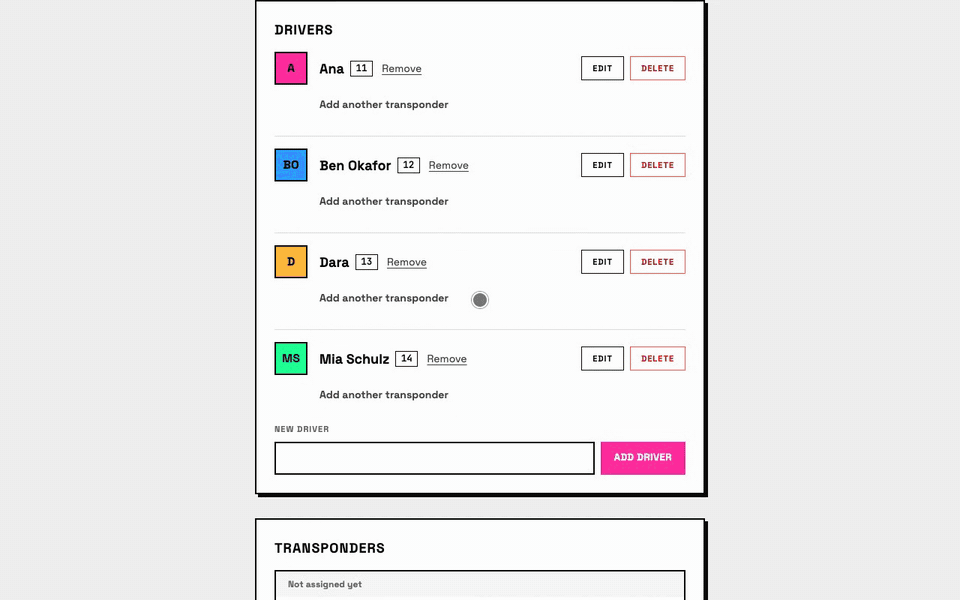

# TinyLap

Lap timing for Kyosho Mini-Z club racing, live on every screen at the track,
and a planner for the tracks you race on.



*TinyLap Timing: a new driver, a race, a personal best and a new track record.*

## What's in it

- **TinyLap Timing** (`apps/timing`): lap timing for practice, qualifying and
  races. Standings, the fastest lap and the track record update live on every
  screen, a TV at the track included.
- **TinyLap Planner** (`apps/track-planner`): design Kyosho Mini-Z Grand Prix
  Circuit 30 tracks and see which pieces you still need. A downloaded track is
  a single file that opens in any browser.
- **TinyLap Accounts** (`apps/accounts`): sign-in with passkeys, and clubs with
  members. Timing needs it; the planner works without it.
- **Decoder and transponder firmware** (`firmware/`): build your own lap
  counter.

Timing signs you in through Accounts and imports its tracks from the Planner.
The Planner runs on its own.

## What you need for timing

- A laptop with Chrome or Edge at the track.
- A decoder at the finish line: build the
  [TinyLap decoder](firmware/tinylap-decoder/README.md) on an ESP32 (USB or
  Wi-Fi), or use an EasyLap or any decoder that speaks the ZRound protocol,
  over USB. More in [docs/timing.md](docs/timing.md).
- A transponder in each car that your decoder reads. You can build them with
  the [TinyLap transponder](firmware/tinylap-transponder/README.md) firmware on
  an ATtiny45.
- A TinyLap Timing server, with Accounts and the Planner beside it
  ([self-hosting](#self-hosting)).

## Development

You need Node 24 and pnpm (through `corepack enable`).

```sh
corepack enable
pnpm install
pnpm check                                   # tests, lint and types in every package
pnpm --filter @tinylap/track-planner dev     # the planner on http://localhost:8000
```

Timing always needs sign-in, so it runs with Accounts and the Planner side by
side: see [apps/timing/README.md](apps/timing/README.md) (Development), which
also covers trying it without a decoder.

## Self-hosting

Each service is one Node 24 process with a SQLite file, built from its own
Dockerfile. Start them in this order: Accounts, the Planner, Timing.

### Accounts

The sign-in service: passkeys, clubs and an OpenID Connect provider.

```sh
docker build -f apps/accounts/Dockerfile --build-arg GIT_SHA=$(git rev-parse HEAD) -t tinylap-accounts .
docker run -p 4100:4100 -v tinylap-accounts:/data \
  -e TINYLAP_ISSUER=https://accounts.example -e BETTER_AUTH_SECRET=<32+ random characters> \
  -e TINYLAP_CLIENTS='[
    {"clientId":"track-planner","clientSecret":"<random>","redirectUris":["https://planner.example/auth/callback"],"postLogoutRedirectUris":["https://planner.example/"],"resource":"https://planner.example"},
    {"clientId":"timing","clientSecret":"<random>","redirectUris":["https://timing.example/auth/callback"],"postLogoutRedirectUris":["https://timing.example/"],"resource":"https://timing.example"}
  ]' \
  -e TINYLAP_FEED_TOKENS=<planner token>,<timing token> tinylap-accounts
```

`TINYLAP_CLIENTS` has one entry per app that signs in, and
`TINYLAP_FEED_TOKENS` one token per app that reads the deletions feed. Each
app gets its own `clientId`, `clientSecret` and feed token from these lists.
All variables, secrets, key rotation and backups:
[apps/accounts/README.md](apps/accounts/README.md).

### Planner

Serves the app and stores shared layouts. Without `TINYLAP_ISSUER` it runs
without sign-in.

```sh
docker build -f apps/track-planner/Dockerfile --build-arg GIT_SHA=$(git rev-parse HEAD) -t tinylap-planner .
docker run -p 8080:8080 -v tinylap-data:/data -e TINYLAP_PUBLIC_URL=https://planner.example \
  -e TINYLAP_ISSUER=https://accounts.example -e TINYLAP_CLIENT_ID=track-planner -e TINYLAP_CLIENT_SECRET=<from TINYLAP_CLIENTS> \
  -e TINYLAP_TOKEN_KEYS=1:$(openssl rand -base64 32) -e TINYLAP_FEED_TOKEN=<planner token> tinylap-planner
```

| Variable | Default | Meaning |
| --- | --- | --- |
| `PORT` | `8080` | Port to listen on |
| `TINYLAP_DB` | `/data/tinylap.sqlite` | SQLite file (`:memory:` for none) |
| `TINYLAP_PUBLIC_URL` | the request's `http://<Host>` | The `https://` origin used in share links. Set it behind TLS |
| `TINYLAP_RATE_LIMIT` | `30` | Posts per hour per client |
| `TINYLAP_CLIENT_IP_HEADER` | none | Header carrying the client IP behind a proxy (`Fly-Client-IP` on Fly). Never set it without a proxy that overwrites it |
| `TINYLAP_ISSUER` | none | The Accounts origin. Unset, sign-in is off. Set, the variables below are required, or the planner refuses to start |
| `TINYLAP_CLIENT_ID`, `TINYLAP_CLIENT_SECRET` | none | The planner's entry in Accounts' `TINYLAP_CLIENTS` |
| `TINYLAP_TOKEN_KEYS` | none | Keys that seal stored tokens: `<id>:<base64 of 32 bytes>`, comma-separated, newest first. Old keys still open older sessions, so rotating logs nobody out |
| `TINYLAP_FEED_TOKEN` | none | The planner's token from Accounts' `TINYLAP_FEED_TOKENS`, read on start and hourly |

The API is described at `/openapi.json` and `/api`; snapshots, tracks and
shapes are in [docs/identity.md](docs/identity.md).

### Timing

Needs Accounts (or another OpenID Connect provider, below) and a planner to
import tracks from.

```sh
docker build -f apps/timing/Dockerfile --build-arg GIT_SHA=$(git rev-parse HEAD) -t tinylap-timing .
docker run -p 8080:8080 -v tinylap-timing:/data -e TINYLAP_PUBLIC_URL=https://timing.example \
  -e TINYLAP_ISSUER=https://accounts.example -e TINYLAP_CLIENT_ID=timing -e TINYLAP_CLIENT_SECRET=<from TINYLAP_CLIENTS> \
  -e TINYLAP_TOKEN_KEYS=1:$(openssl rand -base64 32) -e TINYLAP_FEED_TOKEN=<timing token> \
  -e TINYLAP_PLANNER_URL=https://planner.example tinylap-timing
```

| Variable | Default | Meaning |
| --- | --- | --- |
| `PORT` | `8080` | Port to listen on |
| `TINYLAP_DB` | `/data/timing.sqlite` | SQLite file |
| `TINYLAP_PUBLIC_URL` | required | The `https://` origin timing is served at |
| `TINYLAP_ISSUER` | required | The Accounts origin |
| `TINYLAP_CLIENT_ID`, `TINYLAP_CLIENT_SECRET` | required | Timing's entry in Accounts' `TINYLAP_CLIENTS` |
| `TINYLAP_TOKEN_KEYS` | required | Keys that seal stored tokens, as for the planner |
| `TINYLAP_FEED_TOKEN` | required | Timing's token from Accounts' `TINYLAP_FEED_TOKENS` |
| `TINYLAP_PLANNER_URL` | required | The planner tracks are imported from; timing fetches nothing else |
| `TINYLAP_CLIENT_IP_HEADER` | none | Header carrying the client IP behind a proxy |

Timing refuses to start unless every required variable is set.

### Another OpenID Connect provider

The planner and timing can sign in through another provider instead of
Accounts. They refuse to start with sign-in half configured. The provider
must:

- support the authorization code flow with PKCE, and refresh tokens, for a
  confidential client;
- issue **RS256 JWT access tokens** (`typ` `at+jwt`) with `aud` set to the
  app's origin (RFC 8707 `resource`);
- put a `workspaces` claim in them, `[{ "id", "role" }]`, with the roles
  `owner`, `admin` or `member`;
- serve its JWKS at `{issuer}/jwks` (`jwks_uri` from discovery is not read);
- name a `userinfo_endpoint` in discovery that answers the user's `name`: a
  save is refused while the name can't be looked up;
- offer the deletions feed, `GET /deletions?after=<seq>` with the bearer
  `TINYLAP_FEED_TOKEN`, answering
  `{ "deletions": [{ "seq", "kind": "user" | "workspace", "id", "deletedAt" }] }`.
  This one is TinyLap's own; without it, deleted users and clubs stay in the
  apps.

An `end_session_endpoint` is optional; without one, signing out ends only the
app's own session. See [packages/auth](packages/auth/README.md).

## Contributing

Setup, commit rules and ground rules are in [CONTRIBUTING.md](CONTRIBUTING.md).

## License

TinyLap is free software and stays that way. Apps and tools are
AGPL-3.0-or-later, the shared packages (`packages/`) and the firmware
(`firmware/`) are MPL-2.0, and docs are CC-BY-SA-4.0. See `LICENSES/`,
[CONTRIBUTING.md](CONTRIBUTING.md) and [TRADEMARKS.md](TRADEMARKS.md).
